# Dakota1890

**One 1890 dictionary, compiled into a verifiable training environment. Trained on Thinking Machines Tinker and measured in Weights & Biases.**


## New: Inkling 2 Small learns the dictionary on Thinking Machines Tinker

**12 November 2026.** We fine-tuned [`thinkingmachines/Inkling-2-Small`](https://huggingface.co/thinkingmachines/Inkling-2-Small) on Riggs' dictionary with [Tinker](https://tinker-docs.thinkingmachines.ai/), the training API from Thinking Machines. Three passes of supervised fine-tuning cost **$33.70**. Recall of dictionary entries from memory went from **3% to 84%**, and the model still uses its dictionary lookup tool correctly on **100%** of the lookup tasks.

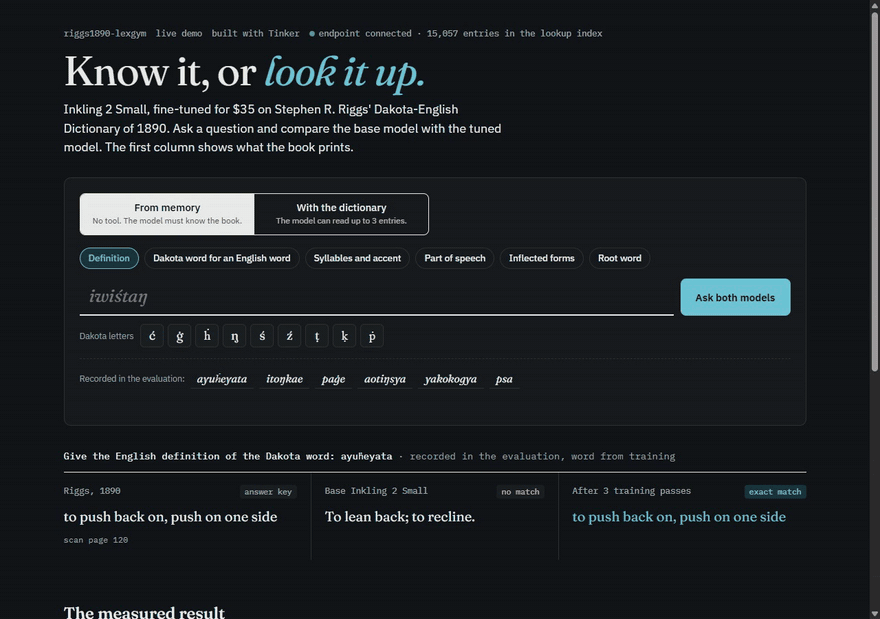

| | |
|---|---|
| **Live demo** | [huggingface.co/spaces/HarleyCooper/riggs1890-lexgym](https://huggingface.co/spaces/HarleyCooper/riggs1890-lexgym). It runs live inference through Tinker's OpenAI-compatible endpoint. |
| **Cookbook** | [harleycoops.github.io/Dakota1890/cookbook](https://harleycoops.github.io/Dakota1890/cookbook/) and [`cookbook/`](cookbook/) |
| **Adapter weights** | [HarleyCooper/Inkling-2-Small-Riggs1890-lexgym](https://huggingface.co/HarleyCooper/Inkling-2-Small-Riggs1890-lexgym) |
| **Data** | [Tasks and lookup index](https://huggingface.co/datasets/HarleyCooper/riggs1890-lexicon-graph) · [every evaluation trace](https://huggingface.co/datasets/HarleyCooper/riggs1890-lexgym-traces/tree/main/sft_mixed_thinking_off_2026_11_12/inkling-2-small) |
| **Charts** | [Weights & Biases project `riggs1890-lexgym`](https://forge.coreweave.com/wandb/christian-cooper-us/riggs1890-lexgym) |

### The result

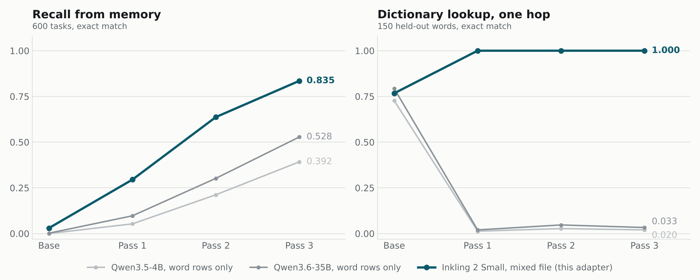

| Exact match, 1,500 tasks | Base Inkling 2 Small | Pass 1 | Pass 2 | Pass 3 |
|---|---|---|---|---|
| Recall from memory | 0.030 | 0.295 | 0.637 | **0.835** |
| Held-out word families | 0.443 | 0.814 | 0.820 | **0.816** |
| Dictionary lookup, one hop | 0.767 | 1.000 | 1.000 | **1.000** |
| Dictionary lookup, two hops | 0.893 | 1.000 | 1.000 | **1.000** |
| All tasks | 0.278 | 0.607 | 0.747 | **0.823** |

A model can answer a dictionary question in two ways: it can know the entry, or it can look the entry up. Our earlier supervised runs on Qwen3.5-4B and Qwen3.6-35B, also on Tinker, learned the book and stopped using the tool. Their lookup score fell from about 0.75 to 0.03. For this run we added solved lookup conversations to the training file. Inkling 2 Small learned the book and kept the tool.

### The run, from the Weights & Biases logs

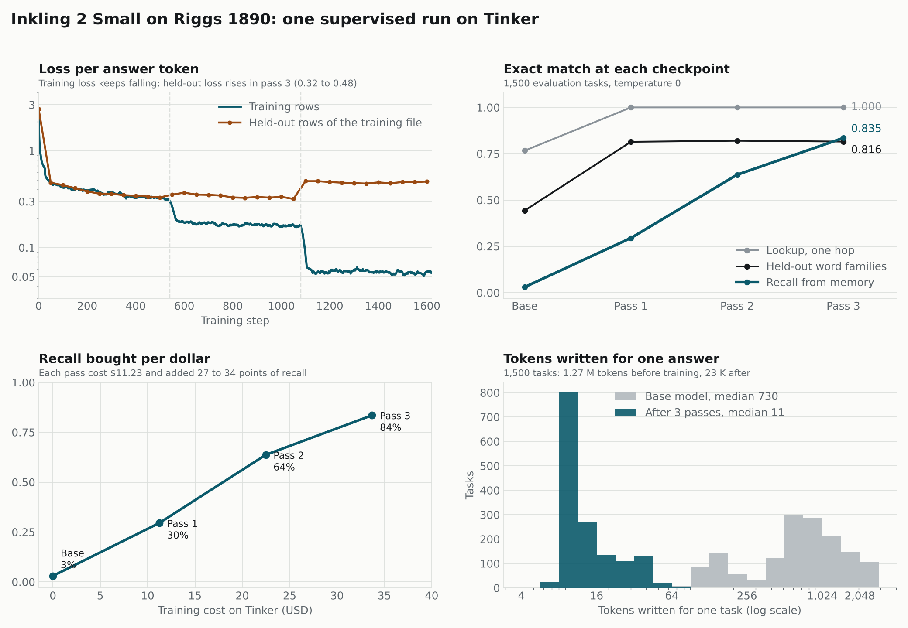

All four panels are drawn from the run's logged metrics and its evaluation traces.

- **Loss.** Training loss falls in a step at the start of each pass. Loss on held-out rows of the training file stays near 0.33 for two passes and rises to 0.48 in pass 3. The model is now memorising, which is the purpose of the recall tasks, and a fourth pass would probably not help the rule tasks.
- **Scores.** Recall rises with each pass. The held-out score is flat after pass 1.
- **Cost.** Tinker charged $11.23 for each pass. Each pass added 27 to 34 points of recall.
- **Tokens.** Before training, Inkling 2 Small wrote a median of 730 tokens for one task, most of them reasoning. After training it writes a median of 11. On the 1,500 evaluation tasks that is 1.27 million tokens against 23 thousand.

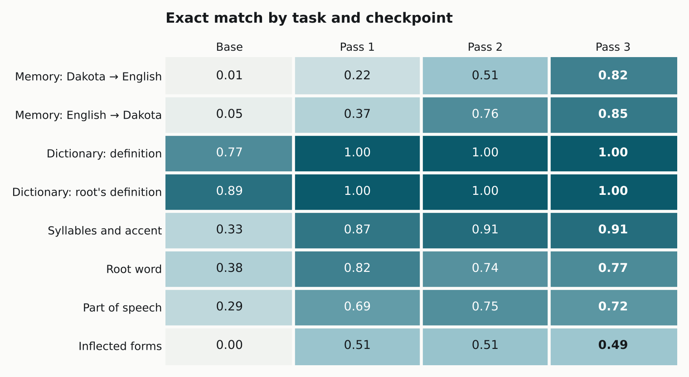

### How Tinker is used

| Step | What runs on Tinker |
|---|---|
| Training | LoRA rank 32 on Inkling 2 Small, 1,620 steps of 128 rows, with `tinker` 0.39.0 and `tinker-cookbook` 0.6.1. Our code runs on a small CPU job and sends batches to the service. |
| Checkpoints | Tinker saves a checkpoint at the end of each pass. Each one can be sampled at once. |
| Evaluation | 1,500 tasks for each checkpoint, sampled through Tinker at temperature 0. |
| Demo | The Space calls Tinker's OpenAI-compatible endpoint for the base model and for the tuned checkpoint. |
| Export | `tinker checkpoint push-hf` converts the checkpoint to the PEFT adapter on the Hub. |

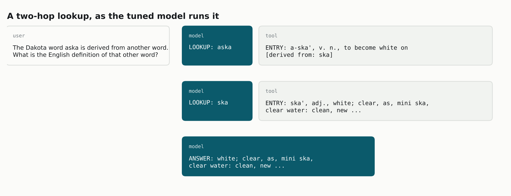

One command starts the whole run as a Hugging Face Job:

```bash
python cookbook/launch_sft_curve_job.py --model-name thinkingmachines/Inkling-2-Small
```

### Limits of this result

- Recall measures memory of words that were in training. It says nothing about new words.
- The model and the training file both changed between the Qwen runs and this run. This run does not show which one kept the tool. A Qwen run on the mixed file is the control.
- All numbers are from one run with one seed.
- A correct score means agreement with one book from 1890. Dakota speakers are the authority on the language.

This is an independent project. Thinking Machines provided Tinker credits and did not review these results.

---

## Next: the verifier loop

A dictionary of this kind has two halves: a grammar and a word list. The word list is now in the model (the section above). The next experiment uses the grammar. It does not use the grammar as a reward for facts, because our earlier RL runs added no facts. It compiles the grammar into an **executable checker** that labels every Dakota form the model or a generator proposes.

| Label | Meaning | Use |
|---|---|---|
| `attested` | The form is printed in the book | Gold |
| `licensed` | An admitted rule builds the form from a headword, and the book does not print it | Training in one arm only. Never gold. |
| `rejected` | The form breaks an admitted rule or the alphabet | Excluded, and logged as an error signal |

The checker drives a loop: generate rows, verify them, retrain with supervised fine-tuning on Tinker, and measure on a frozen evaluation set. RL on Tinker is kept for behaviour (when to look a word up, when to decline). A licensed form becomes gold only with confirmation from a Dakota speaker or a second source. The long-term purpose is the same: a model that is correct for the 1890 book is a starting point that Dakota communities can correct into their own modern language, with weights that they hold.

- **Spec:** [`docs/verifier_loop_spec.md`](docs/verifier_loop_spec.md)
- **Checker v0:** [`lexgym/rules.py`](lexgym/rules.py), with a [live demo](https://huggingface.co/spaces/HarleyCooper/riggs1890-rule-checker)
- **Audit data and worklist:** [HarleyCooper/riggs1890-verifier-loop](https://huggingface.co/datasets/HarleyCooper/riggs1890-verifier-loop)

### First test of the idea (12 November 2026, no GPU)

Before any rule is compiled by hand, [`tools/verifier_loop/insertion_probe.py`](tools/verifier_loop/insertion_probe.py) asks one question: can a small set of edits explain the inflected forms that Riggs prints? The probe learns the edits from the train word families only and tests them on the held-out families.

| Measure | Value |
|---|---|
| Pairs of headword and inflected form | 6,963 train, 664 held-out |
| Edits admitted (seen at least 25 times in train) | 17: 11 inserts and 6 substitutions |
| Most frequent edits | insert `wa` (2,474), `y` → `md` (805), insert `ma` (349), insert `uŋ` (311), insert `ya` (245), `ki` → `we` (240) |
| Held-out forms explained | **73.6%** (81.0% when diacritics are ignored) |
| Train forms explained | 75.3% |
| Different forms the 17 edits can build from one held-out headword | median 93 |
| Position of an inserted `wa` | inside the word 2,089 times, as a prefix 606 times |

What this shows:

- **The rules are real and they transfer.** Seventeen edits learned from one set of word families explain about three quarters of the forms in families the probe never saw. The spec's coverage gate is 60%.
- **A rule can license a form, but it cannot choose one.** The same 17 edits build a median of 93 different forms from one headword, and the book prints one or two. The place of the affix is a fact about each verb. So the hard part of the checker is precision, and attestation must decide which licensed form is correct.
- **The probe found an extraction error in the gold.** In 98 inflected forms, an accented `e` at the start of the form was read as `ć` (for example `ćwahdaku` under the headword `ehdaku`). The probable cause is the variant map in `lexgym/orthography.py`, which maps `é` to `ć`. That mapping was written for headwords. We have not yet checked these 98 forms against the page images.

The full report is in [`tools/verifier_loop/insertion_probe_2026-11-12.json`](tools/verifier_loop/insertion_probe_2026-11-12.json). The probe is a feasibility test. The compiled rule inventory of milestone 2 must cite Riggs' grammar.

---

## Earlier pilot (10 November 2026): Weights & Biases analytics

The first pilot of the new pipeline ran on 10 November 2026: `Qwen/Qwen3.5-4B`, LoRA rank 32, trained on Tinker for $4.73. Every number below comes from the logged metrics of three W&B runs in the project [`christian-cooper-us/riggs1890-lexgym`](https://wandb.ai/christian-cooper-us/riggs1890-lexgym).

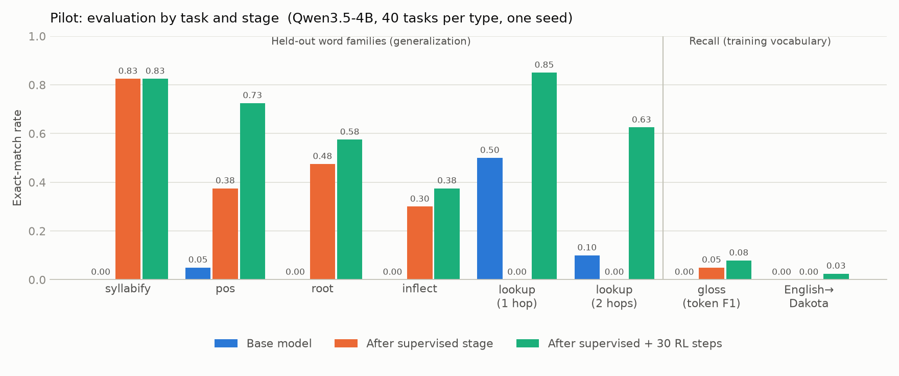

| Measure | Base model | After supervised stage | After supervised + 30 RL steps |
|---|---|---|---|
| Mean reward, held-out word families (240 tasks) | 0.16 | 0.37 | 0.73 |
| Mean reward, recall of training vocabulary (80 tasks) | 0.00 | 0.04 | 0.06 |
| Syllable division and accent, unseen words (exact) | 0.00 | 0.83 | 0.83 |
| Dictionary lookup, 1 hop (exact) | 0.50 | 0.00 | 0.85 |
| Dictionary lookup, 2 hops (exact) | 0.10 | 0.00 | 0.63 |

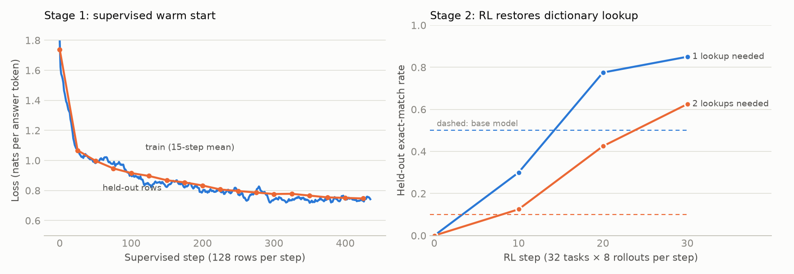

| W&B run | Stage | Size | Tokens | Cost |
|---|---|---|---|---|
| [`pilot-sft-qwen3.5-4b`](https://wandb.ai/christian-cooper-us/riggs1890-lexgym/runs/m54egdyu) | Supervised warm start | 436 steps × 128 rows, one epoch | 4.90 M trained | $3.61 |
| [`pilot-rl-after-sft-qwen3.5-4b`](https://wandb.ai/christian-cooper-us/riggs1890-lexgym/runs/0zl8gdkw) | RL from the supervised checkpoint | 30 steps × 32 tasks × 8 rollouts | 1.03 M trained, 0.96 M prefill, 0.09 M sampled | $1.12 |
| [`pilot-base-eval-qwen3.5-4b`](https://wandb.ai/christian-cooper-us/riggs1890-lexgym/runs/qsc4xl9q) | Base-model evaluation | 320 evaluation tasks | | under $0.01 |

Each run logs the full reward ledger for each task type and each split: exact match, partial-credit components, length guard, parse success, number of lookups, and whether the model reached the target dictionary entry. The raw `metrics.jsonl` files, the run configurations, the Tinker checkpoint paths, and the script that draws these charts are in [`docs/experiments/lexgym_pilot_2026-11-10/`](docs/experiments/lexgym_pilot_2026-11-10/).

The pilot is one seed with 40 tasks per task type. It verifies the method and the tooling. The source is Stephen Return Riggs, *A Dakota-English Dictionary* (1890), a public-domain book.

---

## November 2026 update: the Lexicon Gym

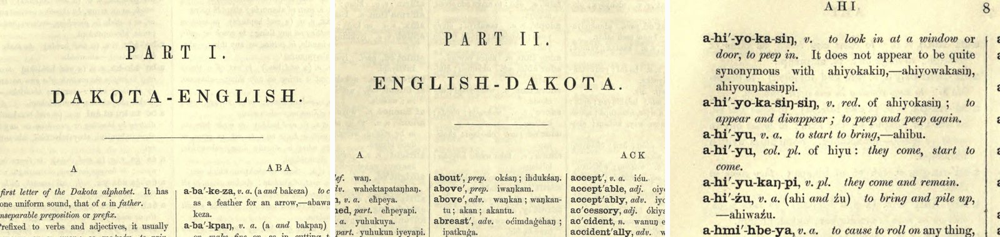

This section describes the current direction of the project. The sections after it describe the 2025 to mid-2026 runs and are kept as the record of that work.

### Why the experiment changed

We audited the reward function, closed its leaks, and ran the clean version again on Tinker. The reward is now honest. The honest result showed a structural problem.

| Run (Qwen3-30B-A3B, LoRA 32, about 200 steps) | Held-out exact match, start → end | English→Dakota exact match |
|---|---|---|
| `tinker_qwen30b_grant_clean` | 0.06 → 0.24 | 0.00 → 0.03 |
| `dakota1890-grant-clean-v3d` | 0.07 → 0.11 | 0.00 → 0.00 |

Policy-gradient RL can only reinforce an answer that the model samples. A base model that does not know a Dakota word does not sample it, so the lexical tasks give no gradient. The gains in these runs are on Dakota→English, where the model answers in English.

The audit also found two data problems:

- The RL environment used only the 1,497 grammar rules. The 24,224 structured dictionary entries that we had already extracted from the scans were not in the environment.
- 1,307 of the 10,576 grammar tasks contained unfilled template text, and the task set had only 5,638 unique answers.

### What changed in the repository

A new package, `lexgym/`, builds everything from the per-page extraction files in `data/extracted/`. It does not depend on the older task files.

| File | Function |
|---|---|
| `lexgym/orthography.py` | Riggs alphabet, mapping of variant glyphs to one form, headword parser (syllables and accent) |
| `lexgym/build_graph.py` | Extraction JSON → lexicon graph with page-level provenance, word families, and splits |
| `lexgym/tasks.py` | Graph → supervised rows, RL tasks, held-out and recall evaluation sets, lookup index |
| `lexgym/scoring.py` | One deterministic verifier per task type and one reward ledger per rollout |
| `lexgym/tinker_env.py` | `tinker-cookbook` `Env`, `EnvGroupBuilder`, and `RLDatasetBuilder`, including the multi-turn lookup tool |
| `lexgym/train_sft.py` | Stage 1: supervised warm start on Tinker |
| `lexgym/train_rl.py` | Stage 2: RL on Tinker, started from the stage 1 checkpoint |
| `tests/test_lexgym.py` | Offline tests: scoring, reward-hack probes, gold answers, split leakage |
| `environments/riggs1890_lexgym/` | The same tasks and scorers as a `verifiers` package for the Prime Intellect Environments Hub. Its [README](environments/riggs1890_lexgym/README.md) is the environment design document. |

```bash
python -m lexgym.build_graph      # data/extracted -> data/lexicon_graph
python -m lexgym.tasks            # data/lexicon_graph -> data/lexgym_tasks
python -m pytest tests/test_lexgym.py
```

`requirements-tinker.txt` now pins `tinker==0.39.0` and `tinker-cookbook==0.6.1`. The Tinker server no longer accepts the SDK version that the earlier runs used.

### Dataset design: one volume, two witnesses

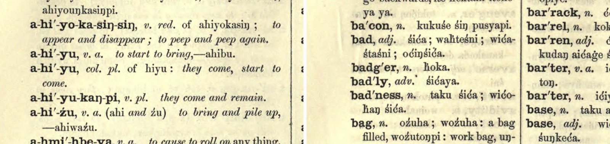

Riggs printed the dictionary in two halves. Scan pages 95 to 370 are Dakota→English and pages 371 to 430 are English→Dakota. The graph keeps both halves and uses each half to check the other.

| Item | Count |
|---|---|
| Extracted entries (336 scan pages) | 24,224 |
| Dakota→English entries | 16,980 |
| – headword with a trusted syllable division and accent | 16,227 |
| – with inflected forms | 5,583 |
| – with a derivation link that resolves to another headword | 3,657 links |
| English→Dakota entries | 7,244 |
| Dakota forms in the English half | 10,779 |
| – that match a headword in the Dakota half exactly | 5,279 |
| – that differ from a headword only by n / ŋ | 1,494 |
| Word families (a headword and all words derived from it) | 12,135 |

Design rules:

- **Provenance.** Every entry, edge, and task carries `entry_id`, the scan page number, and the image file name. Each fact can be checked against the page.
- **Canonical orthography.** The vision model wrote one printed letter with several Unicode characters (four different characters for ŋ, and `é` where the book prints `ć`). `orthography.py` maps these variants to one form and lists each mapping as a hypothesis about the extraction, not about the language. A form that still contains a character outside the Riggs alphabet is kept in the graph but is never used as a gold answer.
- **Two-witness gold.** For English→Dakota, RL and evaluation use only answers that appear in both halves of the book. The 1,494 near matches are a work list for a targeted second reading of those pages.
- **Splits by word family.** One family in ten is held out. A held-out headword and its derived forms do not appear in any training row. The test suite checks that the family overlap is zero.

### The RL environment

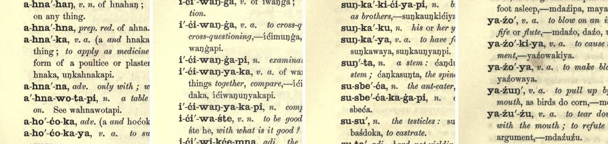

| Task | Input → answer | Verifier | RL train | Held-out |
|---|---|---|---|---|
| `syllabify` | plain word → Riggs syllable division and accent | exact; partial credit for correct boundaries and stress; zero if a letter changes | 13,990 | 1,446 |
| `pos` | word → Riggs part-of-speech abbreviation | exact, closed set | 13,985 | 1,443 |
| `gloss` | Dakota word → English definition | content-token F1 | 13,562 | recall set |
| `inflect` | word → the inflected forms that Riggs lists | set F1 | 4,936 | 482 |
| `root` | derived word → the word it is derived from | set F1 | 3,060 | 287 |
| `en_to_dak` | English word → Dakota word | member of the accepted set; 0.7 if only n / ŋ differs | 3,369 | recall set |
| `lookup_gloss` | multi-turn, 1 lookup needed | content-token F1 on the final answer | 13,562 | 1,401 |
| `lookup_root_gloss` | multi-turn, 2 lookups needed | content-token F1 on the final answer | 2,447 | 225 |

- **Supervised set:** 56,120 chat rows from the six single-turn task types.
- **RL set:** 68,911 tasks.
- **Two evaluation sets with different meanings.** `eval_heldout_rule` (5,284 tasks) uses word families that training does not see, and contains only tasks that a rule or the lookup tool can answer. It measures generalization. `eval_recall` (600 tasks) uses training vocabulary. A new word cannot be guessed, so this set measures memory of the volume, and we report it under that name.
- **Lookup tool.** In the lookup tasks the model can reply `LOOKUP: <word>` up to three times. The environment returns the printed entry as the next message. Reward is paid only on the final `ANSWER:` line. The ledger records the number of lookups and whether the model reached the target entry. These tasks can be learned without prior knowledge of Dakota, and they train the behaviour that a speaker-correction tool needs: read the source, then answer.
- **Reward rules.** No LLM judge. Only the final answer span is scored, so gold text inside reasoning earns nothing. Reward is in [0, 1] with a length guard and no difficulty multiplier. Every component goes to the ledger, so each reward can be reconstructed by hand. The tests include probes for word stuffing, prompt echo, and gold-in-reasoning.

### How we use Thinking Machines Tinker and the cookbook

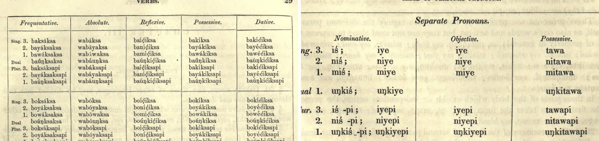

Tinker is the only training infrastructure in the current plan. The training loop runs on a CPU machine, and Tinker does the forward and backward passes.

1. **Stage 1, supervised warm start.** `lexgym/train_sft.py` uses `tinker_cookbook.supervised.train` with `FromConversationFileBuilder` on `sft_train.jsonl`. LoRA rank 32, cross-entropy on the assistant message, the `qwen3_5_disable_thinking` renderer so that the target is one short line. This stage gives the model the vocabulary that RL cannot find by exploration.
2. **Stage 2, RL.** `lexgym/train_rl.py` uses `tinker_cookbook.rl.train` with our own `Env`, `EnvGroupBuilder`, and `RLDatasetBuilder`. It starts from the stage 1 state through `load_checkpoint_path`. Each task is sampled as a group of rollouts and the loss is the cookbook's importance-sampling policy gradient with group-centred advantages. The multi-turn lookup environment follows the pattern of the cookbook's `search_tool` recipe.
3. **Evaluation.** The dataset builder returns the held-out and recall sets as the test dataset, so the cookbook's evaluation loop reports each task and each split separately at a fixed interval.
4. **Monitoring.** The cookbook logger writes `metrics.jsonl` and sends the same metrics, including every ledger channel, to Weights & Biases.
5. **Traces.** The environment writes one row per rollout: the task with its scan page, the whole conversation, the token ids and log-probabilities of every model turn, each reward component, and the advantage. The schema is in [`docs/TRACE_SCHEMA.md`](docs/TRACE_SCHEMA.md).
6. **Publication.** We download the trained LoRA weights from Tinker, convert them to a PEFT adapter with the cookbook, and publish the adapter, the dataset, and the traces on Hugging Face.

### Published on Hugging Face

| Repository | Type | Content |
|---|---|---|
| [`HarleyCooper/riggs1890-lexicon-graph`](https://huggingface.co/datasets/HarleyCooper/riggs1890-lexicon-graph) | dataset | The graph (16,980 Dakota entries, 7,244 English entries, 12,931 edges), 68,911 RL tasks with the two evaluation splits, and 56,120 supervised rows |
| [`HarleyCooper/riggs1890-lexgym-traces`](https://huggingface.co/datasets/HarleyCooper/riggs1890-lexgym-traces) | dataset | Full trace rows for a traced evaluation of the pilot checkpoint (640 evaluation and 256 training rollouts), the ledger summaries of the first pilot (9,616 rollouts), and the raw run folders |
| [`HarleyCooper/Qwen3.5-4B-Riggs1890-lexgym-pilot`](https://huggingface.co/HarleyCooper/Qwen3.5-4B-Riggs1890-lexgym-pilot) | model | The pilot LoRA adapters: supervised then RL, and supervised only |

The first pilot ran before the trace writer existed, so its rollouts have the ledger but no text. The traced evaluation loads the pilot RL checkpoint and records everything. Its 320-task evaluation agrees with the pilot within the noise of 40 tasks per type (for example `syllabify` 0.83 and 0.83, `lookup_gloss` 0.85 and 0.80, `pos` 0.73 and 0.65).

### The Prime Intellect environment

The same environment is published on the Prime Intellect Environments Hub as [`harleycooper/riggs1890-lexgym`](https://app.primeintellect.ai/dashboard/environments/harleycooper/riggs1890-lexgym) (version 0.1.0, public). Its source is in [`environments/riggs1890_lexgym/`](environments/riggs1890_lexgym/). The package holds all 68,911 training tasks, the 5,884 evaluation tasks, and the lookup index (2.1 MB compressed), so it needs no download. It uses the same scoring code as the Tinker path; a test checks that the two copies are identical.

```bash
prime env install harleycooper/riggs1890-lexgym
```

```python
import verifiers as vf

env = vf.load_environment("riggs1890-lexgym", tasks=["lookup_gloss", "lookup_root_gloss"])
```

The design document is the package [README](environments/riggs1890_lexgym/README.md): source and graph rules, the eight task types with their reward rules, the lookup tool, the metrics, and the two evaluation splits. An end-to-end test runs the environment against a scripted model server with four policies (oracle, wrong answer, gold answer hidden in reasoning, lookup only) and passes.

Model plan: `Qwen/Qwen3.5-4B` for pilots and ablations, then `Qwen/Qwen3.6-35B-A3B` for the main run, which permits a direct comparison with our earlier 35B adapter.

### Pilot results (10 November 2026)

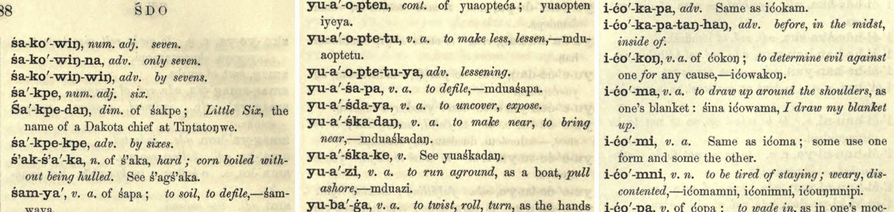

One pilot on `Qwen/Qwen3.5-4B`, LoRA rank 32, all on Tinker. Total cost: $4.73.

- **Stage 1:** one epoch of supervised training, 436 steps of 128 rows, 4.9 million tokens, $3.61. Held-out loss fell from 1.74 to 0.75.
- **Stage 2:** 30 RL steps from the stage 1 checkpoint, 32 tasks × 8 rollouts per step, $1.12.

Exact-match rate on the evaluation sets, 40 tasks per task type:

| Task | Split | Base model | After supervised | After supervised + 30 RL steps |
|---|---|---|---|---|
| `syllabify` | held-out families | 0.00 | 0.83 | 0.83 |
| `pos` | held-out families | 0.05 | 0.38 | 0.73 |
| `root` | held-out families | 0.00 | 0.48 | 0.58 |
| `inflect` | held-out families | 0.00 | 0.30 | 0.38 |
| `lookup_gloss` | held-out families | 0.50 | 0.00 | 0.85 |
| `lookup_root_gloss` | held-out families | 0.10 | 0.00 | 0.63 |
| `gloss` (token F1) | recall | 0.00 | 0.05 | 0.08 |
| `en_to_dak` | recall | 0.00 | 0.00 | 0.03 |

What the pilot shows:

- **The model learns rules of the book that transfer to unseen words.** After the supervised stage it writes Riggs' syllable division and accent correctly for 83% of words from families that it did not train on. The base model scores zero.
- **The two stages do different work.** Supervised training removed the lookup behaviour (0.50 → 0.00), because every supervised target is a direct answer. Thirty RL steps restored it and passed the base model (0.85 for one lookup, 0.63 for two). After RL the model reached the target entry in 100% of the one-lookup tasks and 78% of the two-lookup tasks.
- **One epoch on a 4B model does not memorise the lexicon.** Recall of definitions and of English→Dakota is still near zero. This is the main open problem, and it is the reason for the larger model and more epochs in the main experiment.

Limits of the pilot: one seed, 40 tasks per task type, and a small model. The pilot ran before a scoring correction: at that time an `en_to_dak` task with at least one two-witness form also accepted the other forms printed in the same entry, so the `en_to_dak` value is an upper bound. The generator now accepts only the two-witness forms. Differences of a few points between columns are inside the noise. The raw metrics, the configurations, and the Tinker checkpoint paths are in `docs/experiments/lexgym_pilot_2026-11-10/`.

During the pilot we found two things in `tinker-cookbook` 0.6.1 that we will report upstream. `FromConversationFileBuilder` builds the renderer again for every row, which costs about 0.7 seconds per row with the Qwen3.5 renderer. With `remove_constant_reward_groups=True`, the per-tag train metrics are paired with the wrong task, because the groups are filtered and the builder list is not.

### Proposed changes to GRPO and the compositional reward

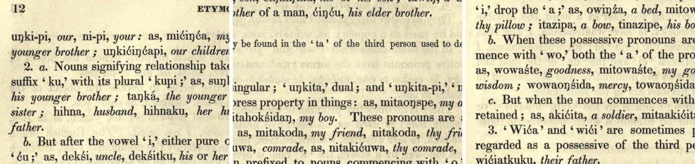

This section is a proposal for the main experiment. None of it is implemented yet. The pilot used the `tinker-cookbook` RL loop without changes.

#### What the pilot loop does now

For each task the loop samples a group of G rollouts from the same prompt. The advantage of rollout *i* is its reward minus the group mean, with no scaling:

```
A_i = r_i − mean(r_1 … r_G)
```

The loss is the importance-sampling policy gradient on the sampled tokens, weighted by `A_i`. In a multi-turn episode every turn gets the same advantage. A group in which all rewards are equal gives no gradient.

The reward `r` is already compositional. Each task type has its own components, and all of them go to the ledger:

| Task | Components | Current composition |
|---|---|---|
| `syllabify` | `letters_ok`, `exact`, `boundary_f1`, `stress_ok` | 0 if `letters_ok` is 0. 1.0 if `exact`. Otherwise 0.6 × `boundary_f1` + 0.2 × `stress_ok`. |
| `en_to_dak` | `exact`, `loose_match` (n / ŋ), `char_dice` | 1.0, else 0.7, else 0.25 × `char_dice` |
| `inflect`, `root` | `set_f1`, `loose_f1` | `set_f1` |
| `gloss`, lookup tasks | `token_f1`, and for lookup `lookups_used`, `target_entry_seen` | `token_f1` on the final answer |
| all | `parse_ok`, `length_mult` | reward × `length_mult` |

#### What the pilot ledger shows

Share of training groups by outcome, mean over the 30 RL steps:

| Task | All rollouts equal and wrong | Mixed (carries gradient) | All rollouts equal and right | Mean reward |
|---|---|---|---|---|
| `syllabify` | 0.00 | 0.34 | 0.65 | 0.93 |
| `root` | 0.14 | 0.57 | 0.29 | 0.63 |
| `pos` | 0.15 | 0.55 | 0.31 | 0.60 |
| `lookup_gloss` | 0.14 | 0.55 | 0.30 | 0.63 |
| `inflect` | 0.28 | 0.49 | 0.23 | 0.49 |
| `lookup_root_gloss` | 0.22 | 0.71 | 0.07 | 0.42 |
| `gloss` | 0.55 | 0.45 | 0.00 | 0.06 |
| `en_to_dak` | 0.05 | 0.95 | 0.00 | 0.03 |

Three problems follow from this table.

1. **`en_to_dak` trains on the wrong signal.** 95% of its groups are mixed, but the mean reward is 0.03. The differences inside a group come from `char_dice`, the character-overlap term. The gradient moves the model toward strings that look like the answer. This is the failure of the earlier Dakota runs in a smaller form.
2. **`syllabify` wastes samples.** 65% of its groups are already all correct and give no gradient.
3. **`gloss` cannot explore.** In 55% of its groups no rollout scores above zero, so RL has nothing to reinforce.

#### Proposed changes

**1. Gated composition in place of a weighted sum.** Order the components of each task from necessary to sufficient, and pay a lower component only as a step toward the next one.

```
r = length_mult × parse_ok × [ gate × ( w_partial × partial + w_exact × exact ) ]
```

- `gate` is the necessary condition of the task: `letters_ok` for `syllabify`; for `en_to_dak`, that the answer contains only letters of the Riggs alphabet.
- `partial` is capped below the lowest reward of a correct answer, so no partial answer can score more than a correct one.
- For `en_to_dak`, `char_dice` leaves the training reward and stays in the ledger as a diagnostic. The reward becomes 1.0 for an accepted form, 0.7 for an n / ŋ difference, and 0 otherwise.

**2. Scale the advantage inside the group.**

```
A_i = ( r_i − mean(r) ) / max( std(r), σ_min )
```

Without scaling, a task whose rewards differ by 0.02 inside a group and a task whose rewards differ by 1.0 push the model with a 50-fold difference in strength. `σ_min` stops noise in an almost-constant group from becoming a large gradient. We will test `σ_min` of 0.1 and 0.25.

**3. Component advantages for tasks with a real partial channel.** For `syllabify`, `inflect`, and `root`, compute a centred, scaled advantage for each component and add them with fixed weights:

```
A_i = gate_i × Σ_k w_k × ( c_k,i − mean(c_k) ) / max( std(c_k), σ_min )
```

A group in which no rollout is exactly right can still rank its rollouts by boundaries and stress. This is used only where the partial component is a correct sub-skill, and never for string overlap.

**4. Route dead groups to a supervised step.** When every rollout of a group scores zero, RL has no signal for that task. The loop will add the gold answer for that task to a replay buffer and take a cross-entropy step on the buffer every N RL steps. Tinker runs both loss functions on one training client, so this is one loop. It gives the lexical tasks a way out of the exploration problem.

**5. Sample tasks where the gradient is.** Draw task types in proportion to their recent share of mixed groups, with a floor for each type. Tasks that are solved (`syllabify`) get fewer samples, and tasks that are dead get the supervised route.

**6. Keep the supervised skills.** Add a KL penalty toward the supervised checkpoint (`kl_penalty_coef` with the checkpoint as the reference model). In the pilot, held-out `syllabify` moved between 0.78 and 0.83 during RL. The penalty limits that drift while the lookup skill is learned.

**7. Lookup process term, as an ablation only.** The final-answer reward stays the only reward by default. One ablation adds 0.1 × `target_entry_seen` when the final answer is wrong, to test whether credit for reaching the right entry speeds up the two-lookup task. The risk is a model that looks up and does not answer, so the term is zero when the episode ends without an `ANSWER:` line.

#### How each change will be accepted

- Each change is one arm against the unchanged loop, on the same base model, seed set, and evaluation sets.
- The measure is held-out exact match for each task type and recall exact match. The training reward is not a measure, because the changes alter it.
- Before any run, the reward-hack probes in `tests/test_lexgym.py` must pass with the new composition: gold inside reasoning, word stuffing, prompt echo, changed letters, and an unclosed thinking block.
- The ledger must still reconstruct every reward from its components.

### Cost of the main experiment

Prices are computed from the pilot's logged token counts and the Tinker price list of 10 November 2026. The same calculation gives $3.61 and $1.12 for the two pilot runs, which matches the logged cost.

| Base model | Supervised, 1 epoch | Supervised, 3 epochs | RL, 300 steps (64 tasks × 8 rollouts) | Three-arm experiment, 1 seed | Three-arm experiment, 3 seeds |
|---|---|---|---|---|---|
| `Qwen/Qwen3.5-4B` | $3.61 | $10.84 | $22.30 | $55 | $166 |
| `nvidia/NVIDIA-Nemotron-3.5-Lightning-30B-A3B-BF16` (discount price) | $2.16 | $6.47 | $12.92 | $32 | $97 |
| `Qwen/Qwen3.6-35B-A3B` | $5.77 | $17.30 | $33.90 | $85 | $255 |
| `Qwen/Qwen3.5-9B` | $7.17 | $21.51 | $36.46 | $94 | $283 |
| `Qwen/Qwen3.8-27B` | $20.11 | $60.32 | $105.60 | $272 | $815 |

The three-arm experiment is one supervised run of 3 epochs and two RL runs of 300 steps (one from the base model, one from the supervised checkpoint). The supervised-only arm is the checkpoint of the first run. The estimate does not include the ablations, the grammar-section tasks, or the second volume.

### Plan

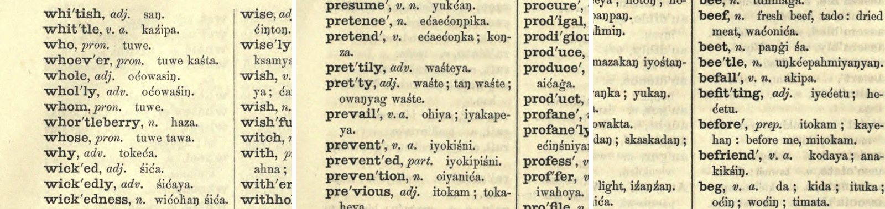

1. **Pilot (done, see above).** Short supervised and RL runs on the 4B model verified the loop, the ledger, and the cost per step.
2. **Main experiment.** Three arms on the same base model and the same evaluation sets: RL only, supervised only, supervised then RL. The question is how much RL adds after the model knows the lexicon, and on which task types.
3. **GRPO and reward changes.** The seven proposed changes above, one arm each.
4. **Ablations.** Lookup tool on and off; two-witness gold against all gold; curriculum order.
5. **Data repair.** A second reading of the pages behind the 1,494 near matches and the headwords that failed the parser, then a new graph version.
6. **Grammar section.** Rebuild the grammar tasks from the 1,497 rules with the same verifier standard and link each rule to the dictionary entries that show it.
7. **Second volume.** Apply the same pipeline to Watkins' *A Dictionary of the Cree Language* (1865), which has the same two-half structure (see `docs/cree1865_source_dossier/`), and test whether a model trained on one volume learns a second volume faster.
8. **Cookbooks.** One short runnable guide per stage (extract, graph, supervised, RL, evaluate), written so that another group can apply the method to its own source volume.
9. **Speaker correction.** A model that is correct for the 1890 book is the starting point for correction by present-day Dakota speakers. That stage needs community authority and review, and the book-trained model does not replace it.

### Limits

- The source is a missionary dictionary from 1890. It records one written variety and is not a description of Dakota as it is spoken now.
- The extraction has errors. The orthography mapping removes some of them and hides none: the raw form stays in every row.
- The pilot is one small run. It verifies the method and the tooling. It is not a result about the language.

---

## The model progression

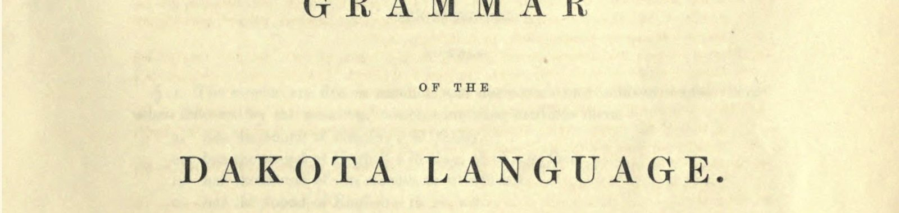

Each model is published on Hugging Face. The arc runs from a 0.6B proof of concept to a 35B GRPO run.

| Model | Params | Method | Infra | Notes |
|---|---|---|---|---|
| [`Qwen3-0.6B-Dakota-Grammar-RL`](https://huggingface.co/HarleyCooper) | 0.6B | GRPO | PrimeIntellect | First proof: grammar rules as a reward signal |
| [`Qwen3-0.6B-Dakota-Grammar-RL-400`](https://huggingface.co/HarleyCooper) | 0.6B | GRPO | PrimeIntellect | 400-step run; 150% reward improvement |
| [`Qwen3.6-35B-A3B-Dakota1890-GRPO`](https://huggingface.co/HarleyCooper/Qwen3.6-35B-A3B-Dakota1890-GRPO) | **35B** | **GRPO** | Tinker | **Latest** — published most recently |

The latest model, **Qwen3.6-35B-A3B-Dakota1890-GRPO**, is the current working endpoint — the toddler that has read the book. It is a live research checkpoint, not an authoritative Dakota assistant.

---

## The pipeline

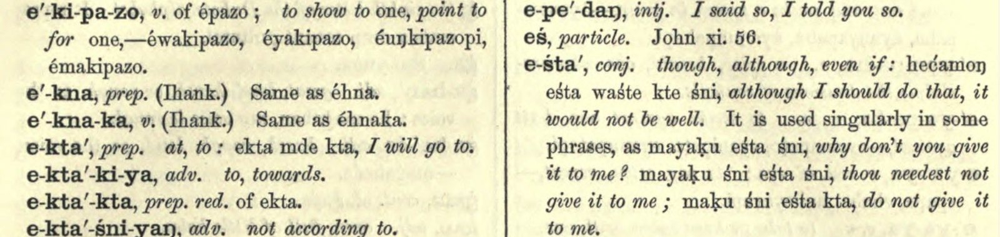

One book becomes a self-contained training loop. No parallel corpus, no separate grammar documentation, no OCR training.

```
1890 Riggs grammar (PDF, public domain)
        │
        ▼
  VLM extraction          Claude reads the scans; preserves ŋ š ć ḣ exactly
        │
        ▼
  Grammar rules           1,497 rules across morphology, syntax, phonology,
        │                 conjugation, particles, translation
        ▼
  RL tasks                10,576 verifiable tasks (≈7.1 per rule):
        │                 morphology, translation, reverse translation,
        │                 syntax analysis, pattern ID
        ▼
  GRPO training           PrimeIntellect / Tinker; the reward IS the grammar
        │
        ▼
  Community correction     descendants of Dakota speakers correct the output —
                           the StoneyNakoda community-in-the-loop stage
```

The key move: grammar rules stop being static documentation and become **executable feedback**. Instead of asking a model to imitate text, the RL loop scores whether each output satisfies the orthographic, morphological, and task-level constraints pulled from the book.

---

## The reward function

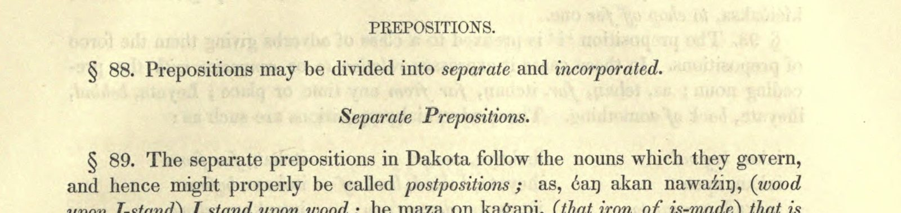

> This section describes the reward of the 2025 to mid-2026 runs. The current reward and the proposed changes are in [Proposed changes to GRPO and the compositional reward](#proposed-changes-to-grpo-and-the-compositional-reward).

The reward is **deterministic**. There is no LLM judge. Every component is independently verifiable, so the gradient is honest and you can see exactly what the model got wrong.

It decomposes a qualitative linguistic task into three measurable primitives:

```python
reward = (
    0.4 * character_preservation +   # orthography: ŋ š ć ḣ ṡ á é í ó ú preserved?
    0.4 * affix_accuracy +           # morphology: correct prefixes/suffixes applied?
    0.2 * semantic_correctness       # semantics: meaning preserved vs. ground truth?
) * difficulty_multiplier            # curriculum weight, 1.0x → 2.0x
```

- **Orthography** — recall of the required special Unicode characters against the source.
- **Morphology** — regex / pattern checks against specific extracted grammar rules (affix presence, possessives like `-ku`, `-ću`, `-tku`, plural `-pi`).
- **Semantics** — similarity to the ground-truth translation or dictionary lookup.

Because each piece is checkable by code rather than judgment, GRPO gets dense, multi-dimensional feedback on **structure**, not just imitation — which is why an RL approach works on a task usually considered too qualitative for it.

---

## See the proof


Everything above is the pitch. Below is what it actually looks like — the source book, the training curves, and the reward signal running live.

### The one book

It all starts with a single public-domain scan: Riggs' 1890 *Grammar and Dictionary of the Dakota Language*.

The grammar section (pages 31–92) and the dictionary section (pages 93–440) are the entire training corpus. No parallel text, no modern annotations.

### The latest run — Qwen3.6-35B-A3B GRPO

The reward channels of the most recent 35B run, restored end to end: composite reward climbs, the pattern channel goes live after the schema fix, char-overlap rises while affix accuracy stays high, and the ledger audit confirms `composite_diff` stayed at zero.

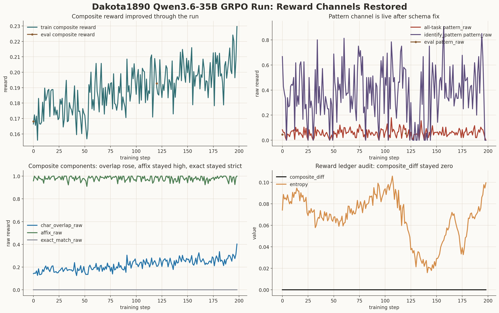

| Composite reward progression | Reward components |
|---|---|
| 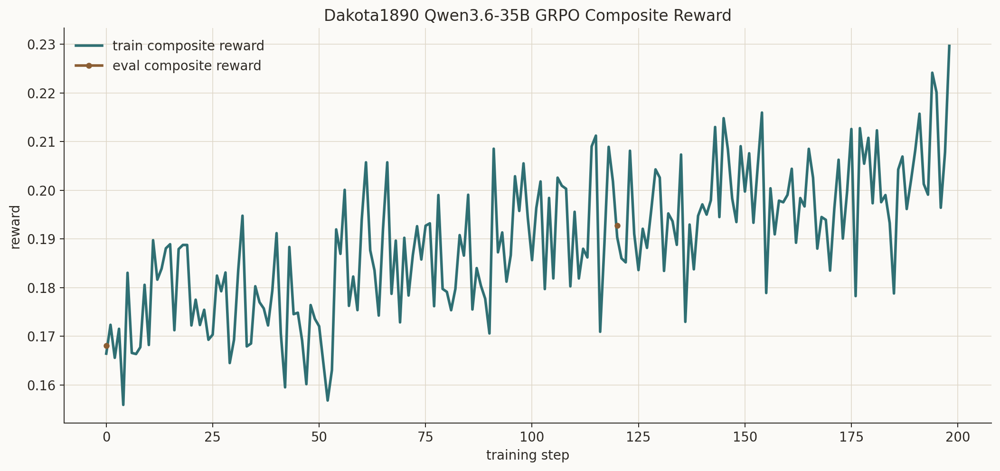 | 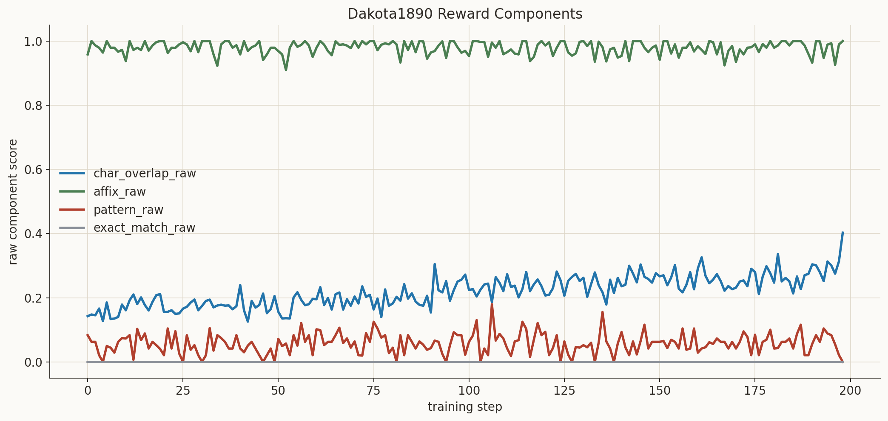 |

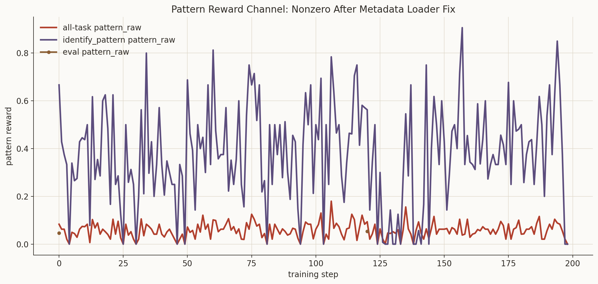

### The reward, running live

The deterministic reward is not a black box. Every component — character overlap, affix accuracy, semantic match, difficulty multiplier — is logged per step. Here is a single Tinker training step with the full ledger broken out:


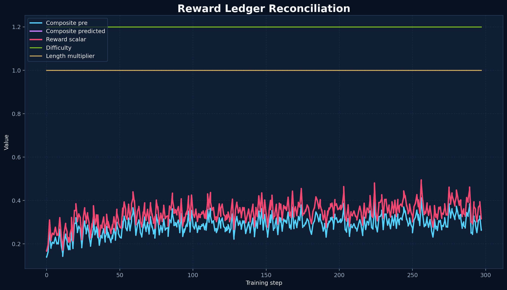

### The method, end to end

How grammar rules become an executable reward function, file by file:


---

## Source material

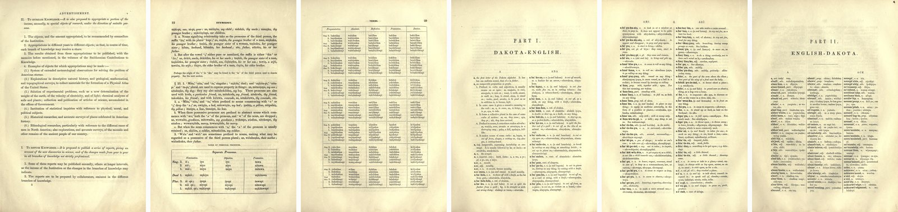

Everything derives from one public-domain book:

> **Riggs, S. R. (1890).** *A Grammar and Dictionary of the Dakota Language.* Washington: Government Printing Office.

- ~665 page scans from the Internet Archive
- Grammar section (pages 31–92) → 1,497 rules
- Dictionary section (pages 93–440) → ~10,000 `{dakota:english}` pairs

Dakota is a Siouan language with a rich orthography — special consonants (`ć`, `š`, `ŋ`, `ḣ`), pitch accents (`á é í ó ú`), and agglutinative morphology. The special characters are what make the reward *verifiable*: they give an unambiguous signal of whether the model preserved the language's structure.

The code is Apache-2.0. The 1890 text is public domain (see `DATA_LICENSE.md`).

### Datasets

- [`HarleyCooper/adaption-dakota-english-qa`](https://huggingface.co/datasets/HarleyCooper/adaption-dakota-english-qa) — 1,950 bilingual Dakota–English QA pairs.
- **Stoney10kRL** — 10K entries from the companion Stoney Nakoda work, applying the same method to a related Siouan language.

---

## How to use

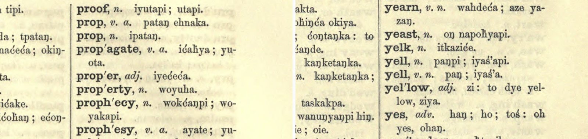

The latest adapter loads on top of its base model with PEFT:

```python
from transformers import AutoModelForCausalLM, AutoTokenizer
from peft import PeftModel

base = "Qwen/Qwen3.6-35B-A3B"
adapter = "HarleyCooper/Qwen3.6-35B-A3B-Dakota1890-GRPO"

model = AutoModelForCausalLM.from_pretrained(base, device_map="auto", trust_remote_code=True)
tok = AutoTokenizer.from_pretrained(base)
model = PeftModel.from_pretrained(model, adapter)

messages = [
    {"role": "system", "content": "You are a Dakota language expert."},
    {"role": "user", "content": "Translate 'my elder brother' to Dakota using the correct possessive suffix."},
]
text = tok.apply_chat_template(messages, tokenize=False, add_generation_prompt=True)
out = model.generate(**tok(text, return_tensors="pt").to(model.device), max_new_tokens=128)
print(tok.decode(out[0], skip_special_tokens=True))
```

Treat the output as a toddler's first attempt — a starting point for correction, not a final answer.

**Live demo:** the **StoneyApp** Space on Hugging Face Spaces shows the community-in-the-loop idea running on the related Stoney Nakoda model.

---

## Companion projects

- **StoneyNakoda** — the project this method came from. It runs the community-in-the-loop correction stage: contemporary Stoney Nakoda speakers correct and extend model output, turning a book-trained model into a living one. Dakota1890 reuses that pattern.
- **StoneyApp** — the live Hugging Face Space demo for the Stoney Nakoda model and its correction loop.

The larger claim is methodological: if a low-resource language has a usable historical source and a community willing to run the second stage, this pipeline can be reused rather than rebuilt.

---

## Links

- **Latest model:** https://huggingface.co/HarleyCooper/Qwen3.6-35B-A3B-Dakota1890-GRPO
- **Prime Intellect environment:** https://app.primeintellect.ai/dashboard/environments/harleycooper/riggs1890-lexgym
- **Lexicon graph and tasks:** https://huggingface.co/datasets/HarleyCooper/riggs1890-lexicon-graph
- **Rollout traces:** https://huggingface.co/datasets/HarleyCooper/riggs1890-lexgym-traces
- **Pilot adapters:** https://huggingface.co/HarleyCooper/Qwen3.5-4B-Riggs1890-lexgym-pilot
- **Dataset (Dakota QA):** https://huggingface.co/datasets/HarleyCooper/adaption-dakota-english-qa
- **W&B training logs:** https://wandb.ai/christian-cooper-us
- **All Hugging Face models:** https://huggingface.co/HarleyCooper
- **Source book (Internet Archive):** Riggs 1890, *A Grammar and Dictionary of the Dakota Language* (public domain)

---

## Acknowledgments

- **Stephen Return Riggs** — the 1890 grammar and dictionary.
- **Internet Archive** — the scanned source.
- **PrimeIntellect** and **Thinking Machines (Tinker)** — RL training infrastructure.
- **Anthropic** — VLM extraction.
- **The Dakota and Stoney Nakoda language communities** — who do the part that actually matters: teaching the model the rest.

## License

Code: **Apache-2.0** (`LICENSE`). Historical Dakota text (Riggs, 1890): **public domain** (`DATA_LICENSE.md`).
